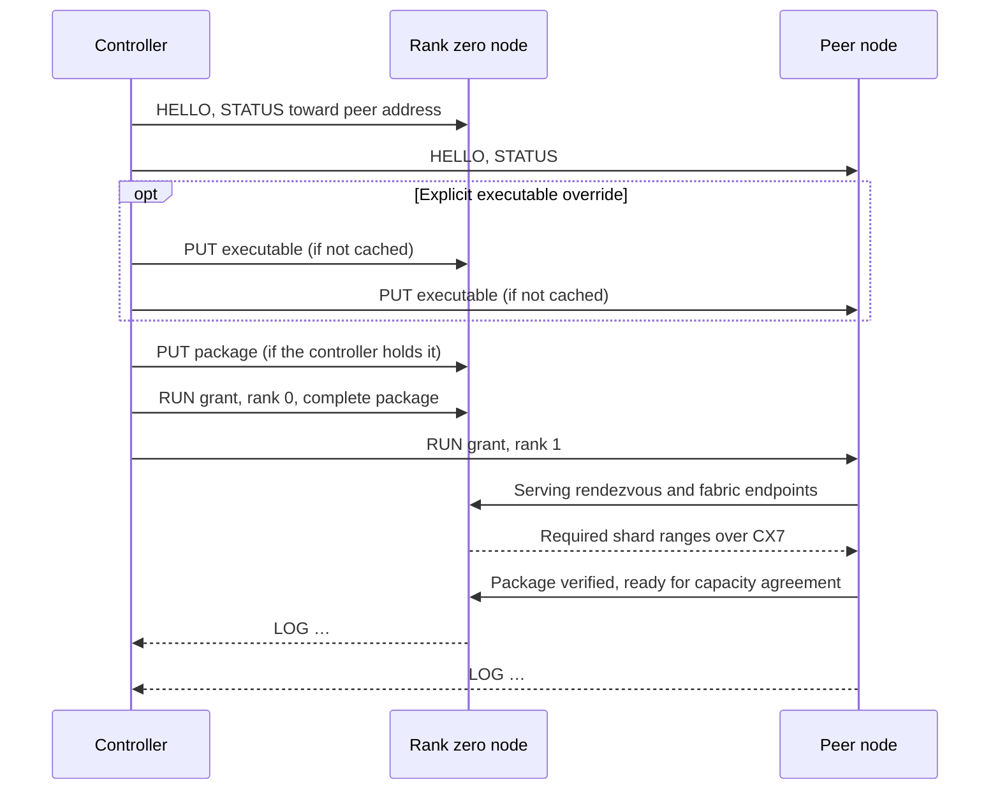

# Orbit

Orbit pairs a controller with Flare agents, places prepared models on their
GPUs, places source packages, and starts and supervises serving groups.
Native serving ranks distribute peer shards through the shared CX7 transport.
The controller runs `flare orbit`; each serving host runs `flare agent`.
The controller needs no model GPU and may use a different CPU architecture
from the serving hosts. Orbit is implemented in Unix builds; Windows builds
reject Orbit commands.

Use [multi-host serving](multi-host.md) for installation, pairing, package
preparation, and a launch example. This reference covers commands, placement,
group lifecycle, storage, and the agent protocol. Discovery, fabric checks,
preparation through agents, and automatic reconciliation are
[proposals](orbit-proposals.md), not available commands.

Every host in a serving group, rank zero included, runs its rank under its
agent. The ranks keep the rendezvous, capacity agreement, and RoCEnante
transport described in [multi-host serving](multi-host.md). Orbit assigns
processes to hosts and authenticates control and file-transfer requests.

## Commands

| Command | Where | Effect |
| --- | --- | --- |
| `flare agent install [--join-code CODE] [--accept-first] [--listen ADDR]` | Node | Installs the executable copy and user unit, restarts the service, requests linger, and prints pairing details |
| `flare agent pair HOST... [--code CODE]` | Head or controller | Pairs the shared agent identities without a cluster definition |
| `flare agent reset` | Node | Removes authorized controllers; the node becomes unpaired |
| `flare agent --listen ADDR` | Node | Runs the service (the unit's command) |
| `flare orbit pair HOST... [--code CODE]` | Controller | Pairs and records nodes |
| `flare orbit controllers add NAME PUBLIC_KEY` / `remove KEY` | Controller | Writes and distributes the next controller-set revision |
| `flare orbit run [PACKAGE] [--cluster NAME \| --nodes NODE,...] [--name GROUP] [--persistent] [--gpus N,...] [--dry-run] [--detach] ...` | Controller | Places a group on the candidate nodes' GPUs, starts it and attaches; `--persistent` saves its named definition; `--dry-run` prints the placement only |
| `flare orbit ls [--cluster NAME]` | Controller | Saved groups and retained runs on the cluster's nodes with their GPUs and state |
| `flare orbit dashboard [--cluster NAME]` | Controller | The serving process's live metrics dashboard for every group and GPU of the cluster |
| `flare orbit attach [GROUP] [--cluster NAME]` | Controller | Follows retained and live rank output; Ctrl-C detaches |
| `flare orbit stop [GROUP] [--cluster NAME]` | Controller | Stops matching running groups, rank zero first |
| `flare orbit status [--cluster NAME]` | Controller | Shows node capacity, groups, and cache inventory |
| `flare orbit rm GROUP` | Controller | Removes a stopped group's definition and history, or only the history when given a launch identifier |
| `flare orbit forget NODE` | Controller | Removes a node from the orbit file |
| `flare orbit push PACKAGE --to NODE,...` | Controller | Stages package data without starting ranks |
| `flare orbit packages [--cluster NAME]` | Controller | Every node's cache directories with their verification state |

`flare run --rank R --rendezvous ADDR` starts an operator-managed peer and
receives its package from rank zero. `flare run PACKAGE --hosts PEER,...` starts
ordered peer agents while rank zero runs locally. Neither form needs Orbit
placement, cluster definitions, or saved groups. Preparation uses
`ignition export` and `ignition join` with its separate
`[preparation] checkpoint_token_file`; see [multi-host preparation](multi-host.md#prepare-the-package).

## Roles and identities

| Role | Runs | Identity | Authority |
| --- | --- | --- | --- |
| Node | `flare agent`, one per host, as a user service | Node key | Runs serving ranks under a grant from an authorized controller; serves cached files to nodes named in that grant |
| Controller | `flare orbit` commands on any host | Controller key | Pairs nodes, issues grants, attaches to groups |
| Rank zero, peer | `flare run` processes started by agents | None beyond the host | Per-launch roles assigned by the grant |

An identity is one Ed25519 key. It signs grants and controller-set records,
and it authenticates a session by signing the handshake transcript. The
fingerprint is the lowercase hex SHA-256 of the public key, the convention
publisher fingerprints in [signing](signing.md) follow. Every identity check
below compares the key a session authenticated.

| Key | Path | Created by |
| --- | --- | --- |
| Node key | `~/.config/flare/agent/node.key`, mode 0600 | `flare agent install`, or the agent's first start |
| Authorized controllers | `~/.config/flare/agent/controllers.toml` | Pairing and controller-set updates |
| Controller key | `~/.config/flare/orbit/controller.key`, mode 0600 | The first `flare orbit` command |
| Orbit file | `~/.config/flare/orbit.toml` | `flare orbit pair`, edited by the operator |

A node's name defaults to its hostname and is recorded at pairing. Renaming a
host does not change its key or its orbit entry.

## Pairing

Pairing adds a controller's public key to a node's authorized controllers and
the node's public key and address to the controller's orbit file. A node with
no authorized controller is unpaired.

| Mode | Node command | Controller command | Authentication |
| --- | --- | --- | --- |
| Join code | `flare agent install [--join-code CODE]` | `flare orbit pair HOST... --code CODE` | Both sides prove the code inside the session; an on-path relay cannot pass |
| Accept first | `flare agent install --accept-first` | `flare orbit pair HOST...` | None; the first controller to connect is authorized |
| Delegation | None | `flare orbit controllers add NAME PUBLIC_KEY` | Signed by an authorized controller |

`flare agent install` generates a one-time code of 20 random bytes, prints it
as eight groups of four base32 characters, and keeps the SHA-256 of the code,
the HMAC key both sides derive from it, in `~/.config/flare/agent/join-code`
for 24 hours or until a pairing uses it.
`--join-code CODE` installs a supplied code so one code covers an installation
session across several hosts. The controller's PAIR frame carries
HMAC-SHA256 of `"controller" || handshake hash` under that key; the node's OK
carries HMAC-SHA256 of `"node" || handshake hash` under it. The
handshake hash binds both proofs to this session's static keys, so a party
relaying the connection can neither impersonate the controller nor be recorded
as the node. A correct proof authorizes the controller and consumes the code.

Accept-first authorizes without a code and is never the default. It suits a
network the operator already trusts.

Delegation changes the controller set, described under
[controller set](#controller-set), so a laptop and a workstation both control
the same Sparks.

Both pairing modes print each node's name and fingerprint. The operator
compares them with what `flare agent install` printed at the host before
trusting a node for anything that moves executables. `flare orbit forget NODE`
removes a node from the orbit file; `flare agent reset` on a host removes its
authorized controllers and returns it to unpaired.

## Orbit file

```toml
# ~/.config/flare/orbit.toml
[controllers]
body = '{"revision":2,"keys":[{"name":"workstation","public_key":"a0b1…"},{"name":"laptop","public_key":"d4e5…"}]}'
signer = "a0b1…"
signature = "4665…"

[[node]]
name = "maxwell"
fingerprint = "6f3a…"
public_key = "7943…"
address = "maxwell:29900"

[[node]]
name = "hertz"
fingerprint = "c1d2…"
public_key = "88e1…"
address = "10.100.0.13:29900"

[cluster.sparks]
nodes = ["maxwell", "hertz"]
```

Keys and signatures are abbreviated here. Pairing writes complete node and
controller records; add clusters and saved groups without editing signed records.

`controllers` is the signed controller-set record exactly as nodes store it:
the JSON body the signer serialized, the signer's public key, and the
signature, so a node verifies the same bytes the orbit file holds. Pairing
writes revision 1; `flare orbit controllers` writes later revisions. The
operator adds clusters by hand.

A **cluster** is a named, ordered list of candidate nodes. A **group** is a model
launch with selected nodes and GPUs; a persistent group also has a saved launch
definition. For a multi-host package, candidate order constrains rank order.
With exactly one candidate per rank, the first node is rank zero. A longer list
can skip nodes that lack a suitable free GPU. Ring routing follows the selected
rank order, so inspect placement before launching on direct cables.

`run` uses `--nodes`, then an explicit `--cluster`, then a saved group's `nodes`,
then all paired nodes. It does not implicitly select the only named cluster.
`status`, `ls`, `packages`, `dashboard`, `attach`, and `stop` use the sole
configured cluster when `--cluster` is omitted; with several clusters, name one.
`push` takes `--to`; `rm` inspects every paired node.

## Controller set

A node's authorized controllers are one record: a revision number, the list of
controller public keys, and a signature by a key that was in the list at the
previous revision. Pairing creates revision 1 with the pairing controller
alone. `flare orbit controllers add` and `remove` write revision N+1 to the
orbit file, sign it, and send it to every node. A node applies a record only
when its revision exceeds the stored one and its signature verifies against
the stored list; HELLO carries the sender's revision, and a controller whose
record is newer than the node's sends it at the start of every session, so an
unreachable node can receive the update when a controller holding it connects.
A node that has accepted a revocation refuses further controller requests and
updates signed by the removed key. A node that has not received the revocation
still trusts its stored controller set.

`controllers add NAME PUBLIC_KEY` takes a hex public key. `controllers remove KEY`
accepts a controller name, public key, or fingerprint. At least one controller
must remain. Each controller keeps its own orbit file; distribute the updated
public node records, controller-set record, and saved groups to the other
controllers without copying private keys. Updating nodes does not synchronize
the other controllers' local files.

## Launching a group

`flare orbit run PACKAGE [--cluster NAME | --nodes NODE,...] [--name NAME]
[serving options]` proceeds as follows, after [placement](#placement) has
chosen the member nodes and their GPUs.

PACKAGE is a Hugging Face repository `ORG/NAME[@REVISION]`, a primary file on
the controller, or `NODE:/absolute/path` on a paired node. Repository packages
download on a candidate node; see [package sources](multi-host.md#package-sources).
Symlinks to regular files are accepted, including Hugging Face cache snapshots.

This sequence shows a two-rank launch with the package source on rank zero:



1. The controller resolves PACKAGE. `ORG/NAME[@REVISION]` selects a Hugging Face
   repository. An explicit `--revision` overrides the suffix; otherwise the
   controller infers the revision from available candidate GPUs, refusing mixed
   hardware unless the operator supplies a revision or narrower node/GPU constraints.
   The first candidate node with an available selected GPU downloads the pinned
   package and its companions. `--filename`, `--offline`, and `--cache-dir`
   apply to that node's Hub cache. The controller reads `--token-file` locally
   and sends its token through the encrypted agent session. It then resolves
   the downloaded file as a node-held package, including publisher verification
   and acceptance on the controller, and refreshes candidate status before
   placement. A repository's default group name is its repository name without
   the owner or revision suffix. Repository resolution can download files
   even with `--dry-run`; no serving process starts in that mode.
   A local path is read directly. `NODE:PATH`
   refers to a package a node holds, from which the controller fetches the
   safetensors header, the signed index, and each companion's header into a
   sparse mirror. The controller verifies the index and obtains
   publisher acceptance as `flare run` does, and computes each rank's byte
   ranges from the index with `runtime_package::rank_ranges`.
   Source files may be symbolic links to regular files, including files on
   another filesystem. STAT rejects missing or nonregular targets before the
   controller mirrors metadata or starts package transfers. Keep the source
   files and links unchanged until transfer and serving have finished.
2. The controller connects to every node in the cluster, agrees on protocol
   versions, and checks STATUS for a free GPU and sufficient disk. Rank zero's
   STATUS, asked `toward` the first peer's address, returns the address rank
   zero's host uses to reach its peers; the controller places it in the grant
   as the rendezvous address.
3. The controller issues the grant with the selected nodes and GPUs in rank order.
4. Each node uses the executable running its installed agent for serving.
   The controller prints the path advertised in HELLO and sends no executable
   by default, regardless of the controller's architecture. `--executable PATH`
   selects a controller-local build to upload and run on every node; a saved
   group's executable override has the same effect. The override must be
   compatible with every selected node. Agents cache it by content and reuse
   it on subsequent launches. If a node does not advertise an installed
   executable, the controller refuses the default launch before transferring
   package data and asks for an agent update or an explicit override.
5. Rank zero needs the complete package. It reads a source already on its host
   in place; otherwise the agents stage the complete source there. The controller
   uploads a controller-local package to rank zero. Peer shards are received by
   serving bootstrap after rank processes start.
6. The controller sends RUN to every node, rank zero first. Rank zero's agent
   starts `flare run PACKAGE --rank 0 --rendezvous 0.0.0.0:PORT` with the
   grant's serving options and HTTP bind; peers start with `--rank R
   --rendezvous ZERO:PORT` without a package argument. Serving ranks exchange CX7
   endpoints, then receive missing files and ranges through parallel streams.
   They verify stored data and publisher trust before capacity agreement and GPU
   loading. Verified cache entries are shared with `orbit push` and manual runs.
7. The controller prints rank zero's HTTP address and, unless `--detach` was
   given, follows output with `[rank R name]` prefixes. Process startup does not
   establish HTTP readiness: wait for the serving message or a successful
   `/health` response.

Rank zero's `--host` and `--port` apply on rank zero's host; the controller
prints the resulting URL and does not proxy requests.

## Process ownership

The agent owns its rank process for the life of the process. A controller
disconnecting, sleeping, or crashing does not stop a group; the agent retains
about 64 KiB of output per rank for a later ATTACH. `flare orbit run` stops
the group on Ctrl-C; `flare orbit run --detach` returns after process startup;
`flare orbit attach GROUP` follows retained and live output; Ctrl-C in `attach`
detaches without stopping ranks. `flare orbit stop GROUP` stops matching running
groups. Both accept a name or exact launch ID and operate within the selected
cluster. Omitting GROUP attaches to all retained runs or stops all running groups
in that cluster.

Stopping sends STOP to rank zero and waits for its EXIT; rank zero drains
native work and the group shuts down through its coordinated shutdown. Peers
still running 30 seconds after rank zero exits receive STOP. Peers are not
signaled while rank zero drains, because the drain needs their collectives.

The agent's systemd unit keeps `KillMode=control-group`: stopping or restarting
the service stops its ranks. `flare agent install` replaces the agent copy and
restarts that service. An APT upgrade only replaces `/usr/bin/flare`; updating
the running agent requires a separate install. Upgrade agents between groups.
Collective failures are reported by the ranks and their agents. An agent does
not restart ranks. Several groups run under one agent on disjoint GPUs, as
[GPUs and groups](#gpus-and-groups) describes.

## GPUs and groups

Orbit allocates GPUs within hosts. A DGX Spark is a node with one
GPU; a workstation with sixteen RTX PRO 6000 GPUs is a node with sixteen,
running one agent. The agent reads its GPUs through NVML, loaded dynamically
like the CUDA driver, without creating a context: index, UUID, name, hardware
revision (`gb10`, `gb202`, `gb300` from the PCI device id or compute
capability), memory total and free, and utilization, memory-controller
utilization (the share of the sample period with memory reads or writes),
temperature, and SM clock where NVML reports them. These utilization values are
not measurements of bytes per second. Integrated GPUs whose NVML memory query
is unsupported use host `MemTotal` and `MemAvailable`. Unsupported metrics appear
as missing values rather than zero. The dashboard's weight bandwidth is a model
estimate, not a hardware memory-traffic counter.

STATUS carries three lists beside the node's identity and free cache space.

| List | Entry |
| --- | --- |
| `gpus` | Index, UUID, name, revision, memory total and free, utilization, temperature and SM clock where present, and the running group holding the GPU, if any |
| `groups` | Every group the agent runs or retains, oldest first: identifier, name, package, rank, GPUs, pid, state, exit status, uptime |
| `packages` | Every cache directory: name, files with sizes, whether its stored data verified, bytes on disk |

A group has an operator name selected with `--name`, defaulting to the explicit
cluster name or the package filename stem. Its launch ID is unique per run.
A grant's member names the UUIDs its rank uses, and the agent exposes exactly
those through `CUDA_VISIBLE_DEVICES` with contiguous local GPU ordinals, refuses
a GPU the node lacks or one a running group holds, and otherwise runs the group beside
the others, each a separate process with its own retained output. A member
naming no GPUs takes the whole node. Run history is separate from a saved group
definition. The agent retains successful runs for five minutes after exit,
capped at sixteen successful runs in launch order. Nonzero exits and running
ranks are exempt from both limits. The sampling loop and group queries prune
expired history even when no further groups start. Pruning removes retained logs
and metrics without deleting saved definitions or model packages, or interrupting
an already attached log stream. Run history is held in memory and is lost when
the agent restarts, including failed-run logs. STOP and ATTACH name a group when
several are on the node. `flare orbit ls` lists saved definitions and every
retained run on a cluster's nodes; `attach` and `stop` take a name or launch
identifier.

A package is one of two kinds, and the package says which. A multi-host
package of N ranks needs N nodes, each giving its rank one GPU, and runs over
RoCEnante. A single-host tensor-parallel package of N ranks needs one node
with N free GPUs and runs as one process over PCIe collectives; its grant
names one member with those GPUs and `single_host`, and the agent starts it
without a rank or rendezvous. [Placement](#placement) chooses the nodes and
GPUs of either kind.

## Persistent and ephemeral groups

An ordinary `flare orbit run PACKAGE` creates an ephemeral group. After a
successful exit, its run history expires. A failed run remains available for
`attach` until explicitly removed or the agent restarts.

Use `--persistent --name NAME` to save a launch configuration in the controller's
orbit file. The saved definition remains after stop, history expiry, and reboot:

```sh
flare orbit run maxwell:/data/flare-runtime/glm53-tp2.safetensors \
  --cluster sparks --name glm53 --persistent --detach \
  --host 0.0.0.0 --port 8000 --max-concurrency 16
flare orbit stop glm53
flare orbit run --name glm53 --detach
```

Persistence saves the package reference, serving settings, candidate nodes in
rank order, GPU constraints, publisher profiles, trust-store path, and any
executable override. Local package, executable, and verification paths are saved
as absolute paths. The definition is written after placement validation and
before starting ranks, so a startup failure can be retried. `--dry-run` saves
nothing. A later run uses the saved configuration; overrides affect that launch
only unless `--persistent` is passed again. An existing running group with the
same saved name on the candidate nodes prevents another launch.

`flare orbit ls` keeps saved groups visible when stopped. An unreachable node
makes an inactive saved group's state unknown. Saved definitions belong to the
controller's orbit file; other controllers need that file to reuse them.
Persistence does not start services automatically after reboot. Start a stopped
group with `flare orbit run --name NAME`.

`flare orbit rm NAME` removes a saved definition and all retained runs with that
name. `flare orbit rm RUN_ID` removes only that launch's history, keeping its
saved definition. Removal requires all paired nodes to be reachable and refuses
a selected running rank. It leaves cached model packages in place. Agents must
support the REMOVE request to clear their history.

Persistent groups can also be declared directly in the orbit file:

```toml
[[group]]
name = "glm53"
package = "maxwell:/data/flare-runtime/glm53-tp2.safetensors"
serving = ["--max-concurrency", "16"]
rank_zero = ["--host", "0.0.0.0", "--port", "8000"]

[[group]]
name = "glm-a"
package = "maxwell:/data/flare-runtime/glm53-tp2.safetensors"
nodes = ["maxwell", "hertz"]
```

`flare orbit run --name glm53` takes the package from the group of that name
when the command names none, puts the group's `serving` words before the
command line's serving options so the command line overrides them, and puts the
group's `rank_zero` words before explicit command-line HTTP options. It takes
`nodes`, `gpus`, `roce_ring`, `transfer_streams`, and `executable`
as constraints when the command line gives none. `nodes` lists candidate
nodes in rank order; `gpus` lists the NVML indices every member uses on its
node. A group without them is placed from the whole orbit.

## Placement

`flare orbit run` places a package on the candidate nodes: those `--nodes`
lists, else the cluster `--cluster` names, else the group's `nodes`, else
every node of the orbit that answers STATUS. The planner turns the package's
needs, read from its signed index, and the nodes' STATUS reports into
members with GPUs, or an explanation naming the node or GPU that cannot
serve. It applies these rules in order:

1. Only GPUs whose revision equals the package's are candidates.
2. A GPU is free when no running group holds it and its free memory covers
   the rank's recorded device bytes plus the package's serving reserve.
3. A multi-host package takes one node per rank; a single-host package takes
   its rank count of free GPUs on one node, the set with the most adjacent
   indices and the lowest indices on ties, or exactly the indices `gpus`
   names.
4. With a candidate list, its order is the rank order: rank r takes the
   earliest listed node after rank r−1's that can serve it. Without one, rank
   zero prefers the node holding the complete package verified or the node
   the `NODE:PATH` reference names, and every other rank prefers a node whose
   cache holds its rank verified; ties go to the GPU with the most free
   memory, then the node name. When that greedy choice leaves a rank without
   a node, earlier ranks are reassigned, so the planner fails only when no
   assignment exists.
5. On a node, a rank takes the lowest-index free GPU of the right revision.

The controller prints the placement, one member per line with its node, GPU
and whether the node already holds its rank, before transferring payloads.
`--dry-run` stops there after metadata verification and node queries. The planner
does not set `--memory-limit`; groups on disjoint GPUs retain their own serving
memory settings. Placement does not check ring adjacency; routing follows the
selected rank order.

## Package caching

Agents and native serving receivers share `~/.cache/flare` in their account:

| Location | Contents |
| --- | --- |
| `packages/<export>-<primary-size>/` | Complete package for rank zero or single-host serving |
| `packages/<export>-<primary-size>-rank<R>/` | Files and ranges needed by a peer rank |
| `blobs/<sha256>.safetensors` | Immutable payloads shared by package directories through hardlinks |
| `bin/flare-<digest-prefix>` | Uploaded executable overrides |
| `publishers/` | Public publisher profiles passed by controllers |

Snapshot exports have a metadata-only primary and payload files bounded by the
`64G` shard limit. Peers receive only the blobs their rank needs. A content-named
blob is transferred whole and checked against its filename hash; package
directories hardlink it from the blob store. A later snapshot with the same blob
reuses those bytes. Packages with numbered or monolithic data files transfer
selected ranges into sparse files instead. Their logical lengths can greatly
exceed allocated disk space; use `du` to inspect allocation.

The source of `NODE:PATH` is read in place. A source outside the agent cache is
not copied merely to launch on that node. Hugging Face downloads use the hub
cache directly, while transfers to other hosts populate each agent's own cache.
Keep source primaries, payloads, and symlink targets available while peers fetch
and ranks serve.

A node verifies fetched data before writing a `.verified` marker. New writes
invalidate the marker; a repeated transfer requiring no bytes can reuse it.
Verification failure removes the package directory. Data sent directly by an
authorized controller is not given that marker by PUT. `--verify-weights` asks
each serving rank to digest its stored data during loading as well.

Transfer sessions and running groups pin cache entries. Native receivers hold
file locks through serving, preventing agent eviction or concurrent replacement
of active rank packages. Receiving files can
evict unpinned executable overrides or package directories, but keeps reusable
blobs. Group-history pruning and `orbit rm` remove neither packages nor blobs.
The agent has no blob garbage-collection command; package-directory eviction
alone may reclaim little space when hardlinks still exist in the blob store.

## Prestaging

`flare orbit push PACKAGE --to NODE,... [--roce-ring | --roce-chain]` places a package on nodes ahead of
any launch. It starts no ranks and sends no executable. With one node per
multi-host rank, the first node receives the complete package and each peer
receives its rank's data, in the
listed order. With any other number of nodes, each receives the complete package.
Single-host packages are always staged complete. A node that holds the package
outside its cache is skipped. Node-to-node fetches are verified; a direct upload
from the controller follows PUT's verification rules. `flare orbit packages` lists
every node's cache directories with their file counts, bytes on disk and
verification state. A launch reuses staged package data; an explicit executable
override may still need uploading. Pre-staged package directories are unpinned
after transfer and can be evicted when another package arrives.

With `--roce-ring`, list exactly one node per multi-host rank in physical ring
order. Package bytes follow the fabric TCP paths described below, without
starting serving ranks.

## Metrics and the dashboard

A sampler thread in the agent reads the GPUs once a second and, for every
running group whose rank zero it hosts, fetches `/metrics?format=json` from
the configured bind address, using loopback for wildcard binds. METRICS returns
the latest GPU readings with their holding groups and every group with its
latest document.

`flare orbit dashboard [--cluster NAME]` polls METRICS on every node of the
cluster twice a second, reconnecting to a node that stops answering, and
draws the serving process's terminal dashboard for the orbit through the view
Helios exports: one row per group with prefill and generation rates, active
and queued requests, acceptance, weight bandwidth (verification steps per
second times the decode weight bytes the package declares, or a dash when it
declares none) and KV tokens; the four plots of the selected
group, derived from successive documents with the same rate history the
serving dashboard uses; and one row per GPU with utilization, memory-controller
utilization, free memory, temperature and the group holding it. Groups and nodes
appear and disappear as the agents report them, a node that stops answering is shown as
unreachable until it answers again, the arrow keys select the group, and `q`
leaves.

## Transport

Agents listen on TCP port 29900. Every connection, controller to node and node
to node, is an encrypted, mutually authenticated session built from the `ring`
primitives Helios already links for package signatures: X25519, Ed25519,
HKDF-SHA256, and ChaCha20-Poly1305.

The handshake has three messages:

1. The initiator sends the magic `FLAREFLT`, the protocol version, and an
   ephemeral X25519 public key.
2. The responder sends its ephemeral X25519 public key, then one record
   encrypted under the responder-to-initiator key carrying its Ed25519 public
   key and a signature over the transcript so far.
3. The initiator sends one record under the initiator-to-responder key
   carrying its Ed25519 public key and a signature over the transcript
   including message 2.

Both directions' keys come from HKDF-SHA256 over the X25519 shared secret,
salted with the SHA-256 of the two ephemeral messages; each direction encrypts
with its own ChaCha20-Poly1305 key and a counter nonce. Each side signs the
transcript, so a party that relays the connection cannot present either
identity, and identities travel only encrypted. The handshake hash, the
SHA-256 of every handshake byte, is the channel binding that pairing proofs
include.

A record is a big-endian `u16` length and ciphertext of at most 65535 bytes,
so a record carries at most 65519 plaintext bytes. A frame is a tag byte, a
little-endian `u64` body length, and the body; its header starts a record and
the body continues across as many records as its length needs, so a PUT or
FETCH body of hundreds of gigabytes is one frame. Each connection encrypts on
one thread. Fabric transfers use multiple independent connections per destination
file, and transfers to different nodes also run in parallel.

After the handshake the agent classifies the remote key as an authorized
controller, a node named in an active grant, or unknown. Unknown keys may only
pair.

### Package transfers through fabric interfaces

Native `flare run` distributes peer shards after launch through its own CX7
listeners, with plain TCP and package verification. It shares this path across
manual, agent-assisted, and Orbit launches. No route signatures or encryption
configuration are required by serving bootstrap.

Rank-distributing `orbit push` and agent staging of the source onto rank zero
transfer through the IPv4 interfaces discovered for the CX7 fabric. The controller obtains
endpoint lists from authenticated agents and selects up to two reachable rails
per connection. Direct topology connects each destination to the source rank.
`--roce-ring` uses neighboring agents in rank order. The existing signed grant
includes the endpoints and rank order; no additional configuration or keys are
required. Agent listeners must be reachable at their fabric IPs and configured ports.

In ring mode, each destination pulls from the source along the shortest ring path; payloads
take increasing rank numbers when both directions have equal length. A transfer
from rank 0 to rank 2 in a four-node ring streams through rank 1. Intermediate
agents forward encrypted sessions one record at a time, without storing another
rank's shard. TCP backpressure bounds buffering, and each hop verifies its peer
identity and the signed local and remote interface addresses. Connections bind
their local fabric IP; failed links report errors without retrying through the
management network. `--transfer-streams N` selects 1..64 parallel TCP streams per
destination file (default 8), divided between the available rails. Each stream
pulls a disjoint, approximately equal share of the requested bytes; sparse holes
remain holes. Each destination processes one file at a time. The stream count
applies to each destination, so a source or relay serving several ranks handles
their combined connections. Higher counts increase CPU and I/O concurrency;
benchmark the actual package and fabric before choosing a larger stream count. A saved group's
`transfer_streams` value is reused by `orbit run`, and an explicit CLI value
overrides it. This setting applies to direct and ring distribution and does not affect
collectives. A transfer connection fails after 120 seconds without read or write
progress.

Destinations reuse verified cached files without opening payload connections.
Each receiving worker buffers at most 1 MiB of file data in addition to
encrypted records. Workers write to disjoint offsets in one partial file and
all finish before it is published. A failed stream
cancels its siblings, closes their connections, and removes the partial file
after the workers drain; it cannot publish a verified package. Content-addressed
payloads are hashed from the assembled file before entering the immutable blob
store. Signed-package verification runs after all files arrive.
A controller-held package first uploads to rank zero. A source node outside the
selected group first stages a complete copy on rank zero, then the other members fetch
from that copy.

Controller connections, metadata lookup, and serving rendezvous use the
configured management addresses. Agent payload transfers use encrypted TCP
and require no host routing changes or IP forwarding. Ignition checkpoint and
prepared export transfers use rank-owned fabric helpers with the existing
shared-token authentication. They require no Orbit
agents or signed grants; preparation control and export manifests use the
rendezvous connection.
Ring and direct package transfers use identical package formats; the captured
collective ABI is independent of package transport. Encryption at each hop,
disk throughput, and shared links can limit bulk throughput below interface
line rate.

## Frames

Frame bodies are JSON unless noted. A request receives OK with a body or ERROR
with a message; an ERROR closes the session.

| Frame | Direction | Body | Effect |
| --- | --- | --- | --- |
| HELLO | Both, first frame | Protocol version, public key, controller-set revision, node facts, installed executable path | Must name the key that authenticated the session; agrees on the version; a newer controller-set record follows when the sender has one |
| PAIR | Controller to node | Code proof | Authorizes the controller as described above |
| HAVE | Controller or node to node | Kind, name, size | Whether the cache holds the entry at that size |
| PUT | Controller to node | Kind, name, size, optional ranges, then bytes | Stores an executable or package bytes at their offsets in a sparse file of the package's length |
| CONTROLLERS | Controller to node | Signed controller-set record | Applies a higher revision signed by a current member |
| TRANSFER | Controller to node | Grant, publisher profile, source node, cache directory, files with sizes and ranges | The node fetches those ranges from the source node into its cache, verifies the directory's stored data unless it verified before, and replies when done; a push's grant authorizes transfers alone |
| FETCH | Node to node | Grant, file name, ranges | Streams the file's bytes to a node the grant names, from the package the node holds or its cache |
| FABRIC | Controller to node | None | Reports active RoCE IPv4 endpoints for planning fabric TCP transfers |
| FETCH_FABRIC | Node to fabric peer | Grant, source and destination ranks, rail, file name, size, ranges | Pulls directly or through signed ring endpoints; only the destination stores the bytes |
| GET | Controller to node | Absolute path, offset, length | Streams up to 256 MiB of a node-local file, used to mirror a package's header and index |
| STAT | Controller to node | Absolute path | The package file's size and its companions' names and sizes |
| DOWNLOAD | Controller to node | Repository, resolved revision, filename and cache options, optional access token | Downloads a pinned package and its companions into the node's Hugging Face cache and returns its absolute path |
| RUN | Controller to node | Grant, rank, optional cached executable name, publisher profile | Starts this host's rank on the GPUs the grant's member names, beside other groups on other GPUs, then streams LOG and EXIT; an absent or null executable name selects the agent's installed Flare |
| ATTACH | Controller to node | Group identifier, required when several groups are on the node | Streams the rank's retained output, then live output |
| STOP | Controller to node | Group identifier, required when several groups are on the node | Sends SIGTERM to the rank |
| REMOVE | Controller to node | Exact group identifier | Removes completed run history; refuses a running rank and preserves cached packages |
| STATUS | Controller to node | Optional `toward` address | Name, keys, controller-set revision, free cache space, every GPU with its UUID, revision, memory and holding group, every group the agent runs or retains with its name, rank, GPUs, state and uptime, every package cache directory with its files and verification state, and the local address routing selects toward `toward` |
| METRICS | Controller to node | None | The GPUs as the agent's sampler last read them, with utilization, temperature, clock and holding group, and every group with the metrics document its rank-zero process last served |
| LOG, EXIT | Node to controller | Line; exit status | Output and completion of a serving rank |

RUN uses the agent's installed executable unless it names an uploaded override.
Overrides are checked against their SHA-256-derived cache names. The agent adds
publisher verification arguments from RUN to each rank's command: publisher
acceptance happens on the controller, while every rank verifies its signatures.
Package storage and eviction follow [package caching](#package-caching).

## Grants

A grant is the controller's signed statement of one launch. Every node verifies
it against its authorized controllers before running a rank, fetching, or
serving bytes to another node.

```json
{
  "group": "glm53-20261019T153000Z-3f9c",
  "package": {
    "export": "…",
    "length": 2122414256,
    "files": ["glm53-spark-tp2.safetensors", "<payload-sha256>.safetensors"],
    "source": {"public_key": "7943…", "path": "/data/flare-runtime/glm53-spark-tp2.safetensors"}
  },
  "name": "glm53",
  "members": [
    {"rank": 0, "name": "maxwell", "public_key": "7943…", "address": "maxwell:29900", "gpus": ["GPU-…"]},
    {"rank": 1, "name": "hertz", "public_key": "88e1…", "address": "10.100.0.13:29900", "gpus": ["GPU-…"]}
  ],
  "rendezvous": "10.100.0.12:29800",
  "serving": ["--max-concurrency", "16"],
  "rank_zero": ["--host", "0.0.0.0", "--port", "8000"],
  "roce_ring": false,
  "transfer_fabric": {
    "ring": false,
    "links": [
      [[], [{"from": "10.200.0.12:29900", "to": "10.200.0.13:29900"}]],
      [[{"from": "10.200.0.13:29900", "to": "10.200.0.12:29900"}], []]
    ]
  },
  "single_host": false,
  "issued": 1792420200,
  "expires": 1792420800
}
```

`name` is the operator's name for the group, stable across launches, by which
`attach`, `stop`, and `ls` find it. A member's `gpus` are the UUIDs of the GPUs
its rank uses; the agent exposes exactly those through `CUDA_VISIBLE_DEVICES`
and refuses a grant whose GPUs a running group holds. An empty list leaves the
GPUs to the rank and excludes every other group from the node.
`package.length` is the primary file's size, which names cache entries
together with `export`. `source` names the node holding the package and is
absent when the controller holds it. `issued` and `expires` are Unix seconds;
a grant authorizes RUN for ten minutes, and the controller signs the grant
again before RUN when transfers outlast that.

The signature covers the exact serialized JSON body in the signed record.
A node accepts a RUN only when the grant names its own key at the requested rank,
has not expired, and
carries a signature from an authorized controller. The expiry bounds launch,
not serving: a group keeps running after its grant expires. Serving options
come from the grant, so every rank loads with the same options.

The grant also authorizes node-to-node transfers. A FETCH is served only to a
member of the grant, identified by the key that authenticated the session, for
the package the grant names.

The grant's `transfer_fabric` contains `ring` and a `links[source][destination]`
matrix of rail endpoints. Direct topology records every peer connection; ring
topology records neighbors only. Each link carries `from` and `to` socket
addresses. The topology is present for agent prestaging and source transfer;
serving ranks discover their own endpoints during bootstrap.

The serving rendezvous checks export identity and rank agreement. The grant
authenticates the launch at the agent boundary; rank communication requires a
trusted fabric network.

## Security model

Anyone holding an authorized controller key can run code as the agent's user
on every node of the orbit. The controller key is therefore protected like the
signing key in [signing](signing.md): owner-only permissions, and an encrypted
backup if the orbit must survive losing the machine.

Packages are signed per rank. Native receivers digest received bytes against
the signed index before GPU loading and keep the result in the shared cache.
Agent prestaging verifies received data in the same way, so a compromised source
node that serves tampered weights
makes the transfer fail rather than a rank run them. PUT does not perform
signed-resource verification, though content-addressed blobs are checked against
their filename hashes. `--verify-weights` makes every rank digest its stored data
at load. A compromised node cannot pair other nodes, issue grants, or advance the
controller set.

Removing a controller reaches nodes when any remaining controller connects;
until then the removed key can still launch on nodes it reaches.

`flare orbit forget NODE` removes that controller's node entry; it does not
revoke the controller on the node or stop its ranks. Edit clusters and saved
groups that still name the forgotten node. `flare agent reset` removes the
host's authorized controller record and pairing code, preserving its node key,
cached files, and running processes; it is not a stop or cache-cleanup command.
The controller stores no secrets from nodes. Nodes store controller public keys,
their own key, and cached files. Transfers and
output are encrypted on the controller and node network; RDMA collective traffic and rank-owned preparation TCP are not encrypted.

## Compatibility

The controller and agents must agree on the agent protocol version; `flare orbit`
refuses an agent whose HELLO reports another version. Serving executables must
also support the package's GPU architecture, prepared graph contract, and RoCE
proxy ABI. A controller's CPU architecture does not select the serving build.

Fabric TCP distribution requires agent protocol 6 on the controller and every
agent, including relays. Updating only a serving executable does not update the
resident agents that distribute packages.

HELLO's optional `executable` path advertises support for using the installed
agent binary in RUN. Agents without that field require `--executable PATH`
until updated. RUN still accepts a cached binary name from controllers that
upload executables. Updating the installed agent with `flare agent install`
also updates the default serving executable; restarting the agent stops its
running ranks.

## Limitations

The controller does not proxy HTTP; clients reach rank zero's host directly.
The controller and agents must share the agent protocol version.
Restarting an agent stops its ranks. Routing between controller and nodes uses
the addresses recorded at pairing. Orbit does not configure the RoCE fabric,
interfaces, or firewalls. Ring package transfers select fabric IPs as described
above; other transfers use the paired addresses. All package transfers use
encrypted TCP. Each connection performs encryption on one CPU thread. Throughput depends
on that work, the selected route, storage, and verification.

Discovery, a preflight fabric check, preparation through agents, and automatic
reconciliation are tracked in [Orbit proposals](orbit-proposals.md) and
[the backlog](TODO.txt). Saved groups require manual restart.
