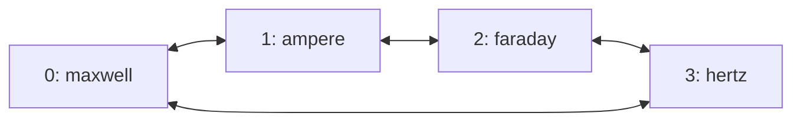

# RoCE ring transport

Flare's experimental `--roce-ring` option connects each tensor-parallel rank to
its neighbors in rank order. A native CPU proxy forwards transfers addressed to
other ranks through those neighbors. The transport supports 2 through 16 ranks;
each model recipe still determines which tensor-parallel sizes it can prepare.
GLM-5.3 Flash and Qwen3.8 Flash prepare multi-host TP2 and TP4 packages.

Ring routing applies to RoCEnante's one-shot reductions, two-shot reductions,
and variable-length gathers. The collective algorithms and arithmetic remain
in the prepared GPU programs. Routing, registered relay buffers, and RDMA
progress belong to the native transport. Serving has no Python callback,
runtime compilation, or steady-state GPU allocation.

Checkpoint reads, prepared exports, and package distribution use multi-stream
TCP on the discovered CX7 interfaces independently of the RDMA proxy. Direct
mode connects to the peer rank; `--roce-ring` and `--roce-chain` select neighbor
relays. Preparation
owns one native transfer helper per rank and needs no Orbit agents. Serving
owns its package receiver and relay, whether ranks start manually, through
`flare run --hosts`, or through Orbit. Agent-based prestaging uses the existing
agent sessions and authorization. See
[checkpoint range reads](multi-host.md) and
[package transfers](orbit.md#package-transfers-through-fabric-interfaces).

The ring can run over a switch or hosts cabled directly to their neighbors.
Forwarding runs on host CPUs; ConnectX hardware hairpin forwarding is not
implemented.

## Rank order and routes

Ranks form the cycle `0,1,...,N-1,0`. With exactly one candidate per rank,
the cluster's node list in the controller's orbit file gives the rank order.
Longer lists can skip unsuitable nodes during placement; use an exact list
and inspect the printed placement to preserve physical neighbor order.
During preparation, each peer's `ignition join --rank` assigns the
corresponding position.

For example, a cluster listing `maxwell, ampere, faraday, hertz`:



Only neighboring queue pairs connect. A transfer to a neighbor uses a direct
RDMA write. A transfer to another rank follows the shorter direction around the
cycle; equal-length paths follow increasing rank numbers, wrapping at N.

| Transfer | Path | Forwarding |
| --- | --- | --- |
| Rank 0 to rank 1 | `0 → 1` | Direct |
| Rank 0 to rank 3 | `0 → 3` | Direct |
| Rank 0 to rank 2 | `0 → 1 → 2` | Rank 1 relays the transfer |
| Rank 1 to rank 3 | `1 → 2 → 3` | Rank 2 relays the transfer |

Two ranks have one distinct neighbor each; three or more have two. A switch
does not add direct connections between non-neighbors in ring mode.

Each serving host discovers its active RoCEv2 devices. Ranks exchange device
endpoints and plan up to two rails per neighbor. On a switched fabric, matching
device indexes carry the rails when their addressing permits it. With direct
cables, the planner pairs local and remote devices on a common IPv4 subnet.
It discovers at most four devices per host, allowing the two PCIe functions of
each cabled Spark port to participate. Every neighbor must have enough reachable
links for the selected rail count.

Flare does not configure interfaces, addresses, cables, switch forwarding, or
firewall rules. A physical ring needs both neighbor links and suitable RoCEv2
addressing already configured.

## Chains

`--roce-chain` serves the same packages over ranks cabled directly as a chain in
rank order: rank 0 and the last rank have one neighbor each and share no link.
Routes connect neighbors only, and a transfer to a non-neighbor always moves
toward its target along the chain, so every rank between the two relays it. The
ends relay nothing. A four-rank chain on hosts cabled `0-1`, `1-2`, `2-3`:

| Transfer | Path | Forwarding |
| --- | --- | --- |
| Rank 0 to rank 1 | `0 → 1` | Direct |
| Rank 0 to rank 3 | `0 → 1 → 2 → 3` | Ranks 1 and 2 relay the transfer |
| Rank 3 to rank 1 | `3 → 2 → 1` | Rank 2 relays the transfer |

A chain is any contiguous stretch of a larger cabled ring, so a group that
leaves part of the ring to other work is a chain even when the whole ring is a
cycle. Relay mailboxes, credits, acknowledgments and the two-shot release wait
are the ring's. Every rank must select the same shape: the ranks exchange it
before planning routes and refuse a mismatch, since a chain rank plans no
route to the far end that a ring rank would wait for. `--roce-ring` and
`--roce-chain` exclude each other. Checkpoint reads, prepared exports and package
distribution follow the same chain routes.

## Transfer progress and buffer ownership

Captured GPU kernels exchange data through a registered host region whose
layout and address are recorded in the package. Kernels stage payloads and
publish readiness words; the proxy posts RDMA writes and publishes the flags
that receiving kernels wait for. The proxy performs transport work, not the
model's reductions.

Ring mode also allocates about 2.01 MiB of registered host memory per rank at
startup. This fixed-capacity region contains relay mailboxes, acknowledgment
words, and outgoing descriptors for up to 16 origins and two rails. It is
separate from captured graph storage and the package's collective region.
Relay payloads occupy at most 64 KiB per packet.

A transfer from rank 0 to rank 2 through rank 1 proceeds as follows:

1. Rank 0's proxy splits each rail's payload into bounded packets. It writes a
   packet into rank 1's mailbox reserved for origin 0 and that rail, then
   publishes the packet's serial number after its payload and descriptor.
2. Rank 1's proxy observes the serial number and validates the destination,
   bounds, and progress toward the destination. For a longer path, it forwards
   the packet to the next relay's mailbox. In this example, rank 2 is already
   its neighbor, so it writes directly into rank 2's collective region.
3. The final payload write is ordered before the destination's readiness flag.
   The last relay waits for its send completion, then acknowledges the packet
   to the preceding hop. Longer paths pass acknowledgments back through each
   relay to the origin.
4. Rank 0 waits for that acknowledgment before submitting its next packet on
   the same rail. Relay buffers and outgoing descriptors remain live until
   downstream acknowledgment permits reuse.

The acknowledgment protects data still being read by a NIC. Receiving GPU
programs consume data through their collective readiness flags and sequence
protocol; a relay acknowledgment does not mean the destination GPU has finished
using the payload.

Every origin has separate mailbox credit on each rail. A stalled origin does
not hold another origin's mailbox. While waiting for credit or completions, the
proxy also progresses incoming relay work. Packets advance toward their
destination rather than circulating indefinitely.

Two-shot reductions need a further lifetime boundary. After posting its
all-gather writes, the proxy waits until its own sends have completed before
publishing `pipe_done`. The GPU kernel waits for that sequence before advancing
the epoch that permits the next operation to overwrite `pipe_send`. Receiving
every peer's output alone does not release a rank's own send buffer.

## Preparation and serving

Follow the [multi-host requirements](multi-host.md#requirements)
first. Use the same Flare revision and locked preparation dependencies on every
host. From each checkout root:

```sh
uv sync --locked --extra prepare --extra test
cargo build --release --manifest-path flare/Cargo.toml
```

Preparation and serving use proxy ABI 10, whose region holds eight packets in flight per sender and
rail. A package prepared with RoCE proxy ABI 9, which holds one, requires re-export. The chain topology
is a mode of the ABI 10 layout, and startup rejects a mismatch before replay.

### Prepare across four hosts

On `maxwell`, choose an unused output filename and an available rendezvous port:

```sh
.venv/bin/ignition export glm-5.3-flash --gpus 0 --ranks 4 \
  --rendezvous maxwell:29630 --roce-ring --transfer-streams 8 \
  --max-concurrency 4 \
  --output /data/flare-runtime/glm53-ring-tp4.safetensors --verbose
```

Run the corresponding command on each peer from its checkout root:

```sh
# ampere: rank 1
.venv/bin/ignition join maxwell:29630 --rank 1 --ranks 4

# faraday: rank 2
.venv/bin/ignition join maxwell:29630 --rank 2 --ranks 4

# hertz: rank 3
.venv/bin/ignition join maxwell:29630 --rank 3 --ranks 4
```

Rank zero sends the `--roce-ring` setting to peers. The plan records `roce_ring`.
`ignition serve` also accepts the option
with `--ranks` for development without package export.

Provision the shared preparation token described in the multi-host guide.
Peers fetch their requested checkpoint ranges through 1..64 streams (eight by
default), alternating the available rails. Rank 2 reads through rank 1 in the
four-host ring. Every rank owns one helper that remains available until all
transfers using that rank as a relay have completed. Frame authentication binds
checkpoint bytes to the source catalog; routes require no signatures or extra
credentials. Range bounds and completion counts are checked. Buffering is
bounded by stream count; one reusable 4 MiB memory-backed file feeds the native
weight loader without writing received weights to peer NVMe. Export payloads
return over the same channels; rank zero assembles and signs the package.
Metadata and coordination use the management rendezvous.

### Serve manually or with peer agents

On rank zero, start the complete package with `flare run PACKAGE --rank 0
--rendezvous maxwell:29800 --roce-ring`. On each peer, start `flare run --rank R
--rendezvous maxwell:29800`. Peers receive missing shards through CX7; no agent
or route credentials are required. Package signatures and publisher acceptance
still apply. The source and every relay remain available until all ranks have
verified their received data.

With paired peer agents, `flare run PACKAGE --hosts ampere,faraday,hertz
--roce-ring` starts those peers in physical rank order while rank zero runs
locally. Both forms accept `--transfer-streams N` on rank zero (default 8).

### Serve through Orbit


From the controller, define the ring's exact node order in the orbit file:

```toml
[cluster.ring]
nodes = ["maxwell", "ampere", "faraday", "hertz"]
```

Then launch:

```sh
flare orbit run maxwell:/data/flare-runtime/glm53-ring-tp4.safetensors \
  --cluster ring --gpus 0 --roce-ring --host 127.0.0.1 --port 8001
```

The example binds HTTP to loopback on rank zero, so access it on Maxwell or
select a reachable bind with `--host`. It uses each node's installed agent
executable unless an explicit override is supplied. The grant carries
`--roce-ring` to every rank. If starting ranks manually, pass
it to every rank along with the usual rank and rendezvous options.
Ranks that disagree about ring mode fail during transport record exchange.

Select ring mode explicitly during serving, including for a package prepared
with the option. The serving flag chooses routing independently of the
package's graph catalog. A compatible ABI 10 package can use either transport
without changing its captured addresses or collective algorithms. Preparation
on a physical ring also needs `--roce-ring`, because non-neighbor direct routes
are unavailable during warmup and capture. A chain (`--roce-chain`) uses the
neighbor transport for collectives, but its checkpoint loading and preparation
export use the preparation rendezvous rather than the agent transfers below.

## TCP data distribution

Bulk data uses the discovered fabric IPs while management connections carry
metadata and coordination. Direct topology connects to the peer; ring topology
forwards through neighbors. Every hop binds its local fabric address and checks
the expected peer interfaces. Failed fabric channels abort the operation without
falling back to management interfaces or changing host routes.

Orbit agent prestaging includes rank order, identities, and endpoints in its
existing signed grant and retains encrypted sessions. Serving ranks exchange
endpoints over rendezvous and transfer plain TCP bytes, with package signature
and stored-data verification. Manual preparation exchanges
endpoints through its rendezvous and authenticates checkpoint/export frames
with its existing shared token, without encryption or signed routes. The
transport supports the dedicated fabric used to cluster Sparks in home and
small-office deployments.

| Workflow | Payload path |
| --- | --- |
| Checkpoint loading | Peers pull their tensor ranges from rank zero through authenticated channels, relayed by neighboring rank helpers where needed. |
| Preparation export | Peers return missing prepared files through the checkpoint transfer channels; rank zero assembles and signs the package. |
| Serving package distribution | Each destination pulls its rank's files directly or through the shortest ring path; intermediate ranks relay without storing the shard. |
| Agent prestaging | `orbit push` transfers rank files through authenticated agent sessions and neighbor relays. |

`--transfer-streams N` selects 1..64 concurrent TCP streams per destination
(default 8), split across the available rails. Checkpoint prefetch holds at
most one 4 MiB payload per stream, plus bounded transport buffers, and feeds
ordered native copies through a reusable memory-backed file descriptor. Export
receives one file per stream in bounded frames. Package distribution splits
each file's requested ranges among streams and preserves sparse holes.

Checkpoint reads validate immutable source snapshots and exact range bounds.
Export files are hashed before atomic publication; publication and temporary
hard-link removal share a lock so concurrent cache verification observes a
stable inode. Transfers and hashing run concurrently. On failure, sibling
connections are aborted and workers are joined; incomplete files are never
published. Cached payloads are verified and reused. Receivers verify the signed
package after transfer.

Stream counts increase CPU, memory, descriptor, and storage concurrency as well
as network concurrency. Orbit encryption, strided checkpoint reads, local hashing,
and shared PCIe bandwidth can limit throughput below the interface line rate.
See [Orbit transfers](orbit.md#package-transfers-through-fabric-interfaces) for
package caching and [multi-host preparation](multi-host.md#prepare-the-package)
for checkpoint admission and export details.

## Validation and limits

The preparation TCP validator exercises discovered CX7 endpoints, authenticated
checkpoint range reads, reverse payload transfers on retained channels, and
helper shutdown without Orbit. From matching Flare checkouts and preparation
environments, run one process per host:

```sh
.venv/bin/python -m tests.preparation.validate_checkpoint_fabric \
  --rank 0 --ranks 4 --ring --rendezvous maxwell:29631 \
  --streams 8 --mib 1024 --token-file ~/.config/flare/agent.token
```

Use ranks 1, 2, and 3 on peers with identical remaining options. Omit `--ring`
for a switched fabric, or use `--ranks 2` without `--ring` for two directly
connected hosts. Each peer verifies 1 GiB of checkpoint ranges and returns
256 MiB over eight authenticated streams. The validator reports transfer time
and interface byte counters. It does not prepare model graphs or assemble a
runtime package. Native socket tests also cover direct and ring paths, stream
failures, and worker cancellation.

FlashInfer provides a CPU-driven validator for the native RDMA proxy at
`tests/experimental/b12x/comm/validate_roce_ring_native.py`. It runs without a
CUDA context and checks mixed one-shot, two-shot, and variable-length transfers,
including empty contributions, unequal shards, delayed senders, and buffer
reuse. From a FlashInfer checkout at the revision pinned in `uv.lock`, run one
process per host with its rank, fabric devices, and GID index:

```sh
python3 tests/experimental/b12x/comm/validate_roce_ring_native.py \
  --rank 0 --world-size 4 --rendezvous maxwell:29783 \
  --iterations 120 --skew-rank 2
```

Use ranks 1, 2, and 3 on the other hosts. Set `--hca-names` and `--gid-index`
for the fabric; keep the other options identical. Add `--mesh` on every rank
to validate direct routing. GPU graph tests additionally exercise changing
message sizes, buffer ownership, and proxy failures during replay. Recovery
from a failed ring neighbor is unsupported; stop and restart all ranks together.

Four DGX Sparks in a physical ring running Flare revision `0a91856` completed
GLM-5.3 Flash TP4 preparation, export, and native inference. Checkpoint and export
payloads used fabric TCP links. Signed-package checks and coordinated shutdown passed.

## Protocol model and runtime checks

The [RoCEnante protocol models in FlashInfer](https://github.com/local-inference-lab/flashinfer/tree/f4ca6f08b7f697da521c212b5b02187a4d82e352/tests/experimental/b12x/comm/formal)
cover GPU staging, proxy posting, NIC payload reads, completion observation,
and relay acknowledgments as separate transitions. FlashInfer owns these models
because its GPU kernels and C proxy define the protocol. Flare vendors the
serving proxy in `helios/native/roce_proxy.c`; preparation uses the pinned
FlashInfer dependency. When changing the protocol, keep the vendored source
identical to the dependency after its provenance header and verify their ABI
and collective-region layouts together.

Flare enforces three boundaries around the protocol:

- Before replay, the native transport checks the package's proxy ABI, collective
  region layout, and routing table. Rank zero waits for every rank to connect.
- After CUDA reports a frame complete, the executor checks transport health
  before publishing its completion records. A proxy failure or GPU control
  error poisons the executor; a kernel timeout is a failed operation.
- At shutdown, the runtime drains replay streams while retaining the transport
  and package. The proxy stops and destroys queue pairs before memory
  registrations and package storage are released. An unconfirmed replay drain
  retains those resource owners until process exit.

The native conformance tests exercise the ABI, preflight rejection, and GPU
control-error interpretation without opening an RDMA device or CUDA context:

```sh
cargo test --manifest-path helios/Cargo.toml --features roce \
  --lib execution::roce::tests
```

This command requires a C compiler and libibverbs development files. Formal
checks use finite configurations and explicit progress assumptions described
with each model. They do not establish CPU/GPU/NIC cache coherence, unbounded
sequence-number behavior, fault recovery, or full-model serving correctness.
The RDMA validator and GPU replay tests exercise the implementation on hardware.

The serving proxy accepts collective generations 1 through 2,147,483,647.
An exhausted sequence fails before another transfer is posted and reports
`RoCE sequence space exhausted`; restart every rank to create fresh transports.
The limit keeps zero-initialized chunk-ready words distinct from staged data
and reserves zero as the healthy error sentinel. It applies to mesh and ring
routing, independently of the number of model steps or requests. Sequence wrap
is unsupported; restarting the proxy thread alone does not reset the runtime.

## Failures

| Symptom | Check |
| --- | --- |
| `--roce-ring requires a multi-host package with 2..16 ranks` | Use a multi-host package with a supported rank count. The flag does not add model sharding geometries. |
| `package RoCE kernels use proxy ABI ...` | Align the preparation dependency and native executable; re-export packages using a different proxy ABI. |
| `RoCE rails have a link to rank ...` | Verify rank order, active ports, GIDs, and the IPv4 subnet shared by each neighbor pair. |
| `ranks disagree on experimental ring transport` | Select `--roce-ring` on rank zero and use matching binaries; serving bootstrap passes its routing mode to peers. |
| Proxy error or collective timeout | Stop the ranks together and inspect the originating rank's error. There is no automatic rerouting around a failed neighbor. |

The transport reports failed waits and RDMA errors through Helios's shared
failure handling. It does not switch to a different topology or publish a
failed collective as a completed model step.

## Implementation

| Component | Responsibility |
| --- | --- |
| [Fabric discovery and route planning](../helios/src/execution/roce_fabric.rs) | Finds host devices and builds symmetric neighbor routes. |
| [Native transport owner](../helios/src/execution/roce.rs) | Validates the package ABI and layout, registers its region, enables the ring, and retains transport resources. |
| [RDMA proxy](../helios/native/roce_proxy.c) | Posts direct and relayed writes, progresses mailboxes and acknowledgments, and releases two-shot send buffers. |
| [Serving distribution](../flare/src/distribution.rs) | Receives and verifies rank packages before handing rendezvous sockets to serving. |
| [Cluster startup](../flare/src/cluster.rs) | Exchanges endpoints and connection records before native replay. |
| [Collective preparation](../ignition/preparation/collectives.py) | Passes the routing choice to b12x and retains the transport through export. |
| [Agent fabric transfers](../flare/src/orbit/agent.rs) | Streams package ranges through authenticated direct or relayed fabric connections. |
| [Fabric TCP planning](../flare/src/fabric.rs) | Selects direct peer links and ring paths for ranks and agents. |
| [Rank channels](../flare/src/fabric_transport.rs) | Owns native preparation and serving listeners and relays. |
| [Preparation transfer coordination](../ignition/preparation/host_ranks.py) | Distributes checkpoint ranges and receives, verifies, and publishes peer exports. |
| [CLI reference](cli-design.md#experimental-roce-ring-configuration) | Defines how preparation and native serving expose the option. |
